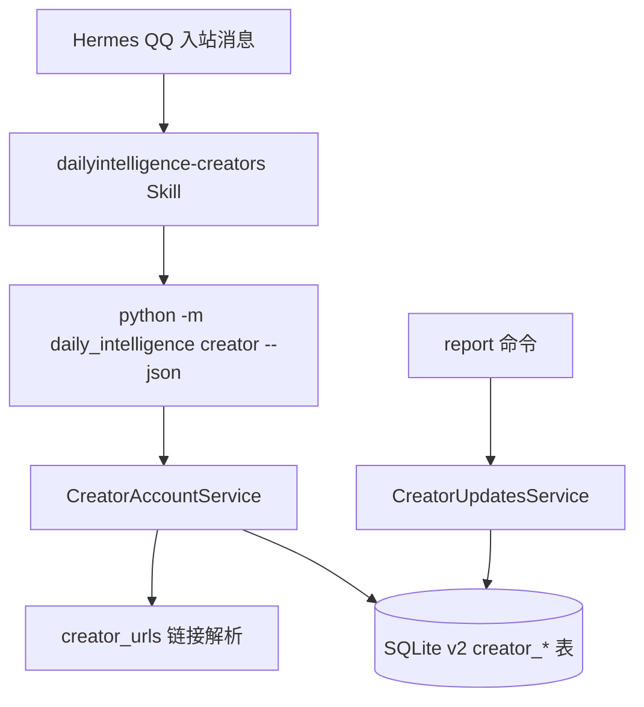

# DailyIntelligence 创作者 Hermes Skill 开发记录

## 1. 背景与目标

DailyIntelligence 已经具备 Bilibili 视频/动态和 YouTube 视频的日报窗口采集，也已有创作者账号、授权 owner、暂停/恢复和监控类型服务。本次只补一个可交给 Hermes 后续安装的独立 Skill，让 QQ Bot 能用自然语言管理这些账号；不重写采集逻辑，不安装到 Hermes 运行目录，不修改 Hermes Profile、Cron 或 Gateway。

## 2. 审计结论

项目根目录为 `E:\YilenaCode\DailyIntelligence`。实际调用链如下：



已确认的代码和数据边界：

- `daily_intelligence/collectors/creators.py` 负责 Bilibili/YouTube 平台采集；Skill 不调用采集器，也不生成日报。
- `daily_intelligence/models.py` 的 `CreatorAccount` 约束平台、账号键、状态和监控类型。
- `daily_intelligence/database.py` 的 `creator_authorizations`、`creator_accounts`、`creator_checkpoints`、`creator_events` 和 `creator_source_runs` 保存授权、账号、检查点、事件和来源运行状态。
- `daily_intelligence/creator_service.py` 提供添加、列表、删除、暂停、恢复和配置，并校验 owner 归属；首次没有预置授权时，只允许第一个可信 sender 原子登记。
- `daily_intelligence/creator_urls.py` 已解析 Bilibili UID、YouTube `/@handle` 和 `/channel/UC...`；YouTube handle 的真实 Channel ID 由现有 `YouTubeClient` 解析。
- `daily_intelligence/config.py` 读取项目 `.env` 和运行时配置；`RuntimePaths` 通过 CLI `--data-dir` 隔离数据库、日报和日志。
- 测试框架为 Python 标准库 `unittest`，网络相关测试使用 Fake opener/隔离数据目录。
- 现有 Skills 使用 Hermes frontmatter：`name`、`description`、`version`、`author`、`license`、`platforms` 和 `metadata.hermes`。新 Skill 沿用该格式，并把命令契约放在 `references/commands.md`。

审计发现原有 `creator` CLI 的 `add/list` 已输出 JSON，但删除、暂停、恢复和配置只输出文本。Skill 无法可靠地依据文本判断 Backend 状态，因此本次增加了显式 `creator --json` 机器契约；无 `--json` 的既有人工输出保持不变。

## 3. 核心修改

### 3.1 Backend CLI 结构化契约

`daily_intelligence/cli.py` 复用现有 `CreatorAccountService`，增加 `creator --json`（兼容放在子命令后的写法）并返回：

- 成功：退出码 `0`、`ok: true`、稳定 `action`；添加/列表返回账号，暂停/恢复/配置重新读取并返回 SQLite 中的实际账号状态，删除返回实际删除目标。
- 失败：退出码 `1`、`ok: false`、`error_code` 和安全错误消息。当前包含 `CREATOR_ALREADY_EXISTS`、`CREATOR_UNAUTHORIZED`、`CREATOR_NOT_FOUND`、`INVALID_CREATOR_URL`、`CREATOR_UNSUPPORTED_MONITORING`、`CREATOR_INVALID_REQUEST` 和 `CREATOR_BACKEND_ERROR`。
- CLI 不直接拼接 SQL；参数仍由 argparse 解析，业务和授权仍由已有服务层执行。

### 3.2 Skill 源文件

交付目录：

```text
skills/dailyintelligence-creators/
├── SKILL.md
└── references/
    └── commands.md
```

`SKILL.md` 负责自然语言意图路由和安全边界：

- 识别 Bilibili 空间链接与 YouTube 频道链接，添加时使用 Backend 默认监控设置。
- 列表按平台分组，展示名称、主页、状态、监控类型和添加时间。
- 删除/暂停/恢复先通过列表按名称或链接解析精确账号；零匹配或多匹配不执行变更，删除始终要求明确确认。
- 修改监控类型时先读取现状并合并未改变的开关；YouTube 动态和直播均拒绝。
- `--owner-key` 只能使用 Hermes 入站上下文中的可信 sender ID；无法传递稳定身份时停止管理，不假设所有 QQ 用户有权限。
- 不采集、不生成日报、不启动服务、不创建 Cron、不写 Hermes Memory、不修改 Profile、不安装 Skill。

`references/commands.md` 记录所有实际 CLI 参数、JSON 成功/失败样例、错误码和独立参数调用安全要求。Skill 不包含固定数据库路径、Cookie 或 Token。

## 4. 验证结果

已执行并观察到：

- 结构化 CLI 契约测试：5 个用例通过，覆盖添加/列表、删除/暂停/恢复/配置、重复、未授权和 Backend 异常。
- `python -m unittest tests.test_cli tests.test_creators tests.test_skills -v`：39 个受影响测试通过。
- `python -m unittest discover -s tests -q`：113 个测试通过。
- `python -m compileall -q daily_intelligence tests`：通过。
- Skill 静态检查确认 frontmatter、引用文件、平台链接规则、错误码、命令解析和边界声明存在；确认 Skill 未写入固定 `E:\HermesData`、`intelligence.db` 或 SQL。

这些结果只证明本地代码、隔离 SQLite、模拟平台响应和 Skill 文本契约。没有执行真实 Bilibili/YouTube 网络请求、Hermes Skill 安装、真实 QQ 入站/出站、Profile 修改或 Gateway 重启。

## 5. 安装交接注意事项

本次交付只保留仓库源文件。后续由 Hermes 安装时，应在目标版本中确认：

1. `skills.external_dirs` 或等价的本地 Skill 来源配置，并同时加载 `dailyintelligence-creators` 及其 `references` 文件。
2. Hermes `terminal` 工具的参数传递方式；项目目录、运行数据目录和 sender ID 必须作为可信运行时参数传入，不能从用户正文拼接。
3. 当前 Profile 的 owner 白名单策略；如果没有 `CREATOR_ADMIN_KEYS`，首次自动登记只适用于首个可信 sender。
4. 安装后先使用隔离数据目录和模拟/只读验证，再决定是否在目标运行数据上执行账号管理。不要把测试账号写入真实监控名单。

本次没有把任何文件复制到 `E:\HermesData`，没有修改 Hermes Profile，没有创建 Cron，也没有重启 Gateway。
