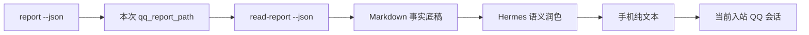

# 日报 QQ 回复语义润色与纯文本输出

## 背景与目标

上一阶段已经让 Hermes 能够读取本次生成的 `.qq.md`，但直接发送 Markdown 会让手机端出现代码块或原始标记。此次补充发送前的语义润色规则：Markdown 只作为可追溯事实底稿，Hermes 必须把它转换成自然中文纯文本后再回复用户。

本阶段不修改采集、推荐、日报落盘内容、消息分段来源或 Cron 调度，也不在 Daily Intelligence 内虚构 QQ Adapter。润色发生在 Hermes 的用户回复阶段。

## 方案

### 允许的变化

- 删除标题井号、加粗/斜体符号、反引号、引用符、三反引号和 Markdown 链接语法。
- 把标题和列表转换为普通文本行和纯文本项目符号，保留原有层级和顺序。
- 翻译说明性英文、状态标签和连接词；调整中文语序、标点和空格。
- 将链接改写为“来源：标题（URL）”等纯文本形式，URL 本身逐字保留。

### 不允许的变化

- 不得删减、总结、合并或重排章节和条目。
- 不得修改日期、时间、数字、版本、来源、状态、`partial`、创作者动态或重要提示。
- 不得翻译 URL、仓库名、账号名、代码标识符和产品/协议专有名词。
- 不得新增日报没有的事实、结论或推荐；失败状态不能润色成成功。
- 不得直接发送 `.qq.md`、JSON、Markdown 原文或带三反引号的消息。

### 发送约束

提示语“今日日报已生成，以下是完整日报正文：”拼接到第一段润色结果，不能单独占用一条没有日期/序号的消息。润色后重新检查消息长度；超限时仍按章节或完整条目拆分，不能截断正文、链接、代码行或状态说明。最后一段保留“日报发送完成。”。

## 修改范围

- `skills/daily-intelligence-local/SKILL.md`：将 `messages` 定义为事实底稿，增加发送前润色、纯文本和结构不变规则。
- `skills/daily-intelligence-local/references/report-polishing.md`：沉淀完整规则、禁止项、自检清单和示例。
- `skills/daily-intelligence-local/references/acceptance-and-hermes.md`：更新 QQ 被动回复验收步骤。
- `README.md`、`deployment/HERMES_INSTALL.md`：补充部署和用户回复说明。
- `tests/test_skills.py`：检查本地 Skill 存在润色规则和关键约束。

## 验证与边界

本阶段通过本地 Skill 静态契约和全量单元测试验证规则文件已加载；Hermes 模型实际措辞、QQ 手机端渲染和真实发送仍需在目标 Gateway/Adapter 环境验收。验收时应检查纯文本外观、链接可点击性、章节顺序、状态保留、长度限制和失败段重试路径。
